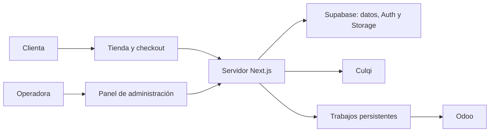

# Arquitectura del proyecto

## Componentes y responsabilidades

| Componente | Responsabilidad |
|---|---|
| Next.js, React y TypeScript | Interfaz pública, panel administrativo y operaciones del servidor. |
| Supabase PostgreSQL y PostgREST | Persistencia, relaciones, políticas RLS y operaciones de datos. |
| Supabase Auth | Identidad y sesiones; el acceso administrativo requiere además un perfil autorizado. |
| Supabase Storage | Archivos de catálogo y portada; documentos privados requieren almacenamiento y permisos separados. |
| Culqi | Procesamiento de pagos mediante los métodos y mecanismos habilitados para el comercio. |
| Odoo | Registro de ventas pagadas y proceso de comprobantes, conforme a la API y permisos de la instalación. |

## Flujo de datos

1. La tienda consulta el catálogo publicado y disponibilidad agregada de Supabase, sin requerir Odoo durante la navegación.
2. El servidor valida carrito, tarifas y totales, crea el pedido y reserva existencias mediante una operación transaccional.
3. Culqi procesa el pago; el servidor reconcilia respuestas y eventos con el pedido propio.
4. La confirmación del pago y la creación del trabajo hacia Odoo se coordinan en una transacción local; un proceso persistente maneja envío, errores y conciliación.
5. El panel consulta pedidos y resultados de integración. El acceso de una invitada a su pedido usa una referencia y un mecanismo de autorización seguro.

## Límites de confianza y decisiones

Las credenciales privadas de Culqi, Odoo y cualquier clave privilegiada de Supabase permanecen en servidor o herramientas administrativas controladas. RLS y validaciones en servidor aplican aunque la interfaz oculte una opción. Un bucket público hace accesible todo archivo cuya URL se conozca.

Los cálculos monetarios deben usar representación precisa y moneda explícita. Los trabajos de integración deben tolerar caídas y reintentos; una búsqueda previa en Odoo no garantiza por sí sola exclusión de creaciones concurrentes. El protocolo y las garantías de proveedores se validan con sus servicios reales.

Mantener entornos de desarrollo, pruebas y producción separados, con migraciones versionadas, tipos generados y configuración documentada en los [README](../../README.md). El estado de ejecución está en [documentacion.md](../documentacion.md).
